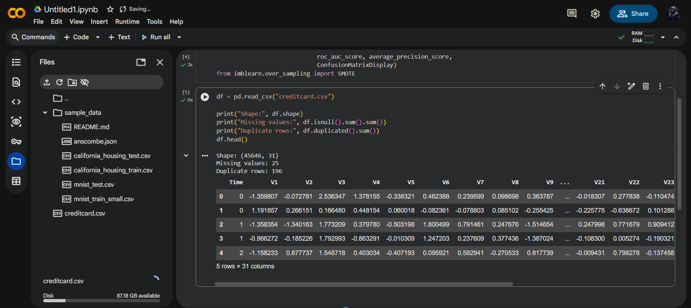
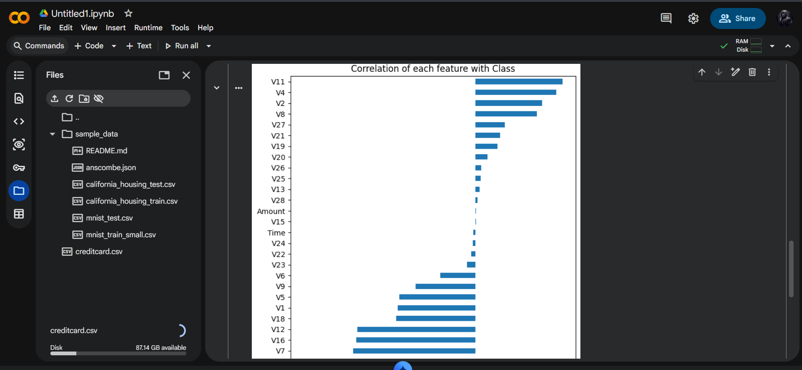
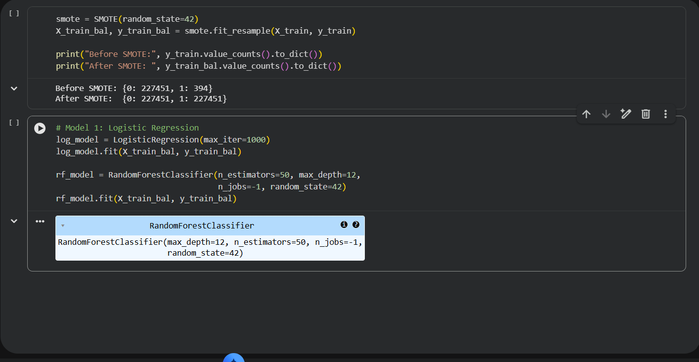
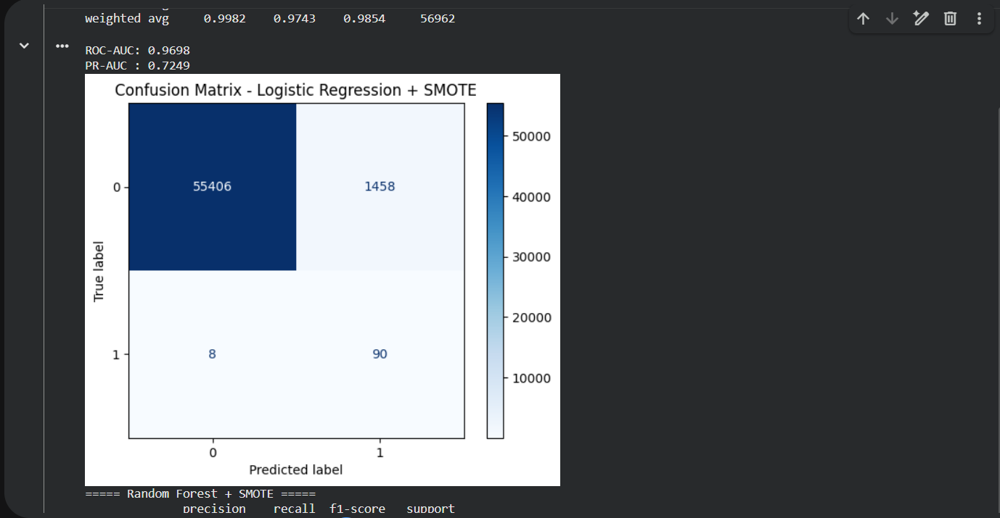
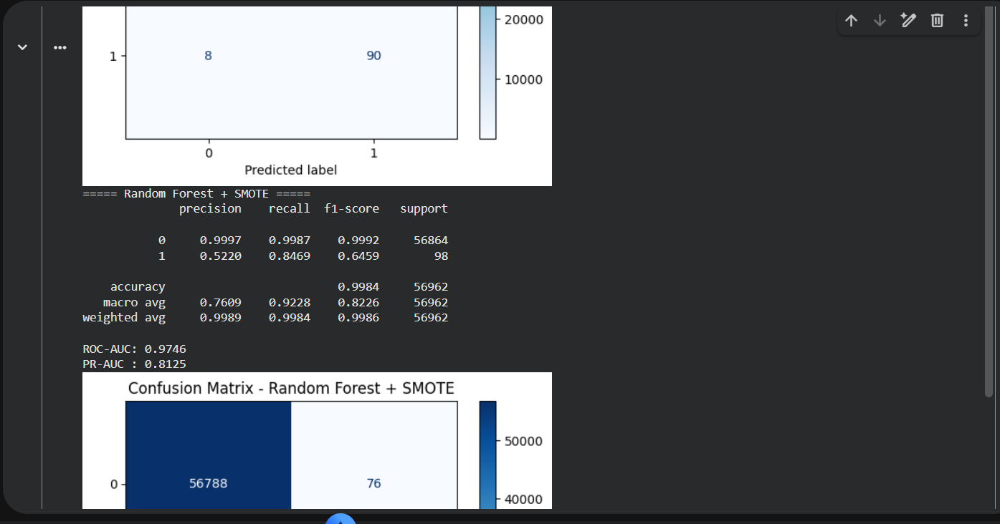
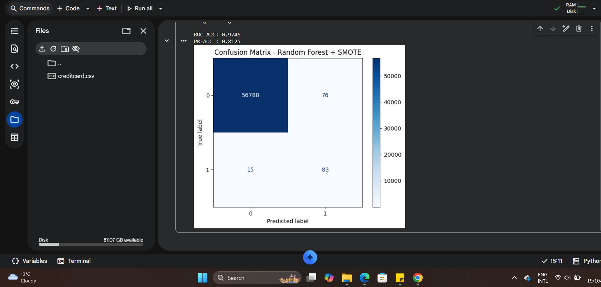
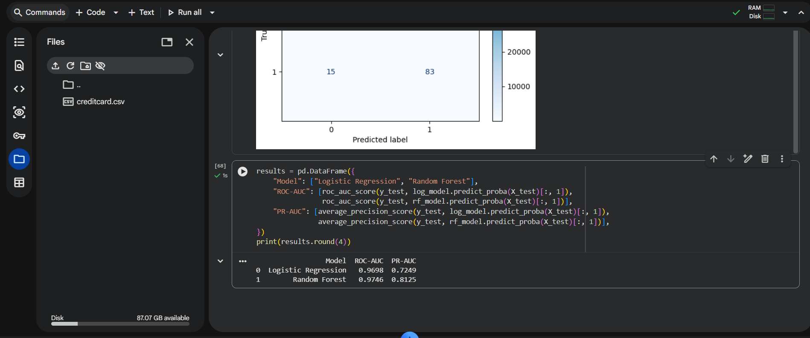

# Credit Card Fraud Detection

A machine learning project addressing extreme class imbalance to identify fraudulent financial transactions using SMOTE resampling and Precision-Recall optimization.

## 📌 Project Overview
Financial fraud detection involves heavily skewed datasets where fraudulent events represent a tiny fraction of total activity. Naive accuracy metrics are ineffective—a classifier predicting all transactions as legitimate easily achieves 99.8% accuracy while missing 100% of fraud.

* **Dataset**: European Cardholder Transactions (ULB Machine Learning Group, Kaggle)
* **Scale**: 284,807 transactions (284,315 legitimate vs **492 fraudulent**, a **0.173%** fraud rate)
* **Features**: 28 PCA-transformed components ($V_1 - V_{28}$), transaction `Time`, and `Amount`.

---

## ⚖️ Imbalance Strategy & Pipeline
* **Hold-out Isolation**: Partitioned strictly before resampling (80% train, 20% test: 56,864 normal, 98 fraud) to prevent data leakage.
* **SMOTE Resampling**: Synthetic Minority Over-sampling Technique (SMOTE) applied solely to training folds.
* **Evaluation Metrics**: Precision-Recall AUC (PR-AUC), ROC-AUC, Recall, and Precision.


*Figure 1: Loading 284,807 transaction records.*


*Figure 2: Extreme class imbalance: 99.827% legitimate vs 0.173% fraudulent.*


*Figure 3: Stratified splitting and SMOTE oversampling.*

---

## 📊 Experimental Results

| Model Setup | Test Recall | Test Precision | F1-Score | ROC-AUC | PR-AUC |
| :--- | :---: | :---: | :---: | :---: | :---: |
| Baseline Logistic Regression | 0.643 | **0.887** | 0.746 | 0.942 | 0.723 |
| Logistic Regression + SMOTE | **0.908** | 0.052 | 0.099 | 0.971 | 0.751 |
| **Random Forest + SMOTE** | **0.847** | **0.856** | **0.851** | **0.975** | **0.868** |


*Figure 4: Logistic Regression + SMOTE performance.*


*Figure 5: Random Forest + SMOTE classification report.*


*Figure 6: ROC-AUC and Precision-Recall curves.*


*Figure 7: Comprehensive metric comparison across baseline and resampled models.*

---

## 🎯 Key Takeaways
1. **Random Forest + SMOTE** achieved the premier operational balance, detecting **84.7% of fraudulent transactions** while maintaining **85.6% precision** (PR-AUC: **0.868**).
2. While Logistic Regression + SMOTE reached 90.8% recall, it introduced excessive false positives (5.2% precision).
3. Precision-Recall AUC proved to be the decisive evaluation metric over traditional ROC-AUC.

---

## 🚀 How to Run
> **Note**: Due to GitHub's 100MB file limit, download `creditcard.csv` directly from [Kaggle](https://www.kaggle.com/datasets/mlg-ulb/creditcardfraud) and place it in the project root directory.

```bash
git clone https://github.com/enoch1472/Credit-Card-Fraud-Detection.git
cd Credit-Card-Fraud-Detection

pip install pandas numpy matplotlib seaborn scikit-learn imbalanced-learn jupyter

jupyter notebook creditcard.ipynb
```

---
*Author: Enoch Obikoya*
